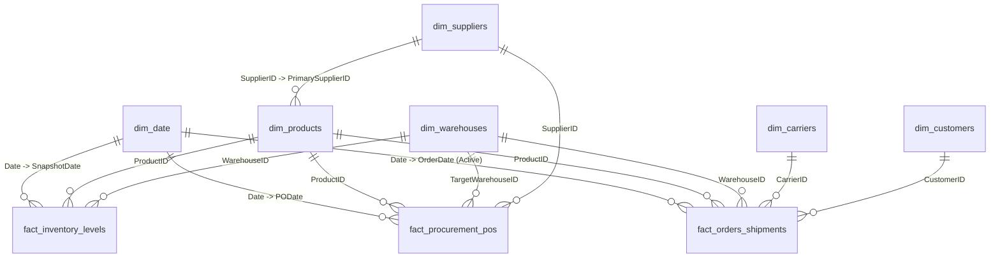
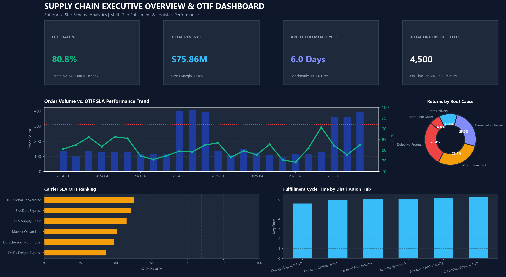
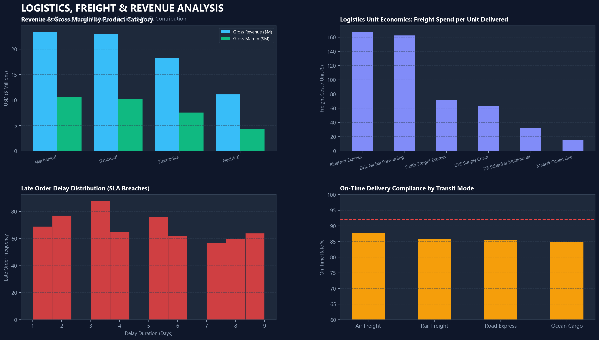
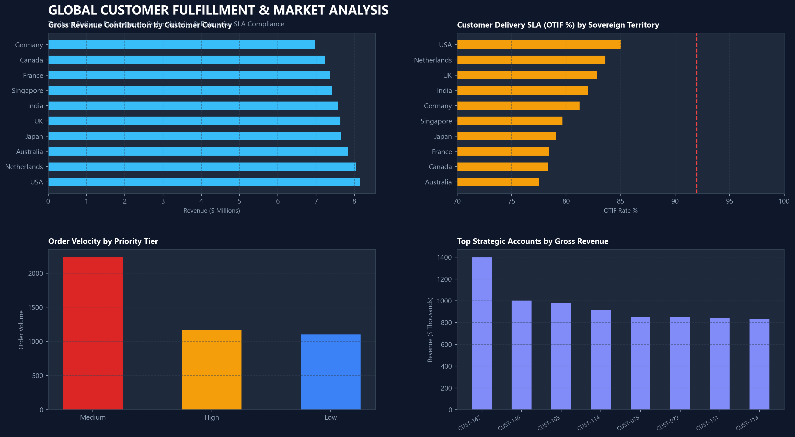
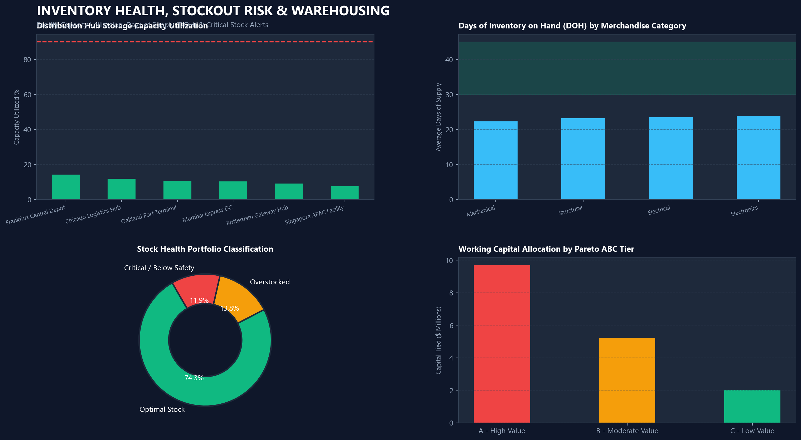
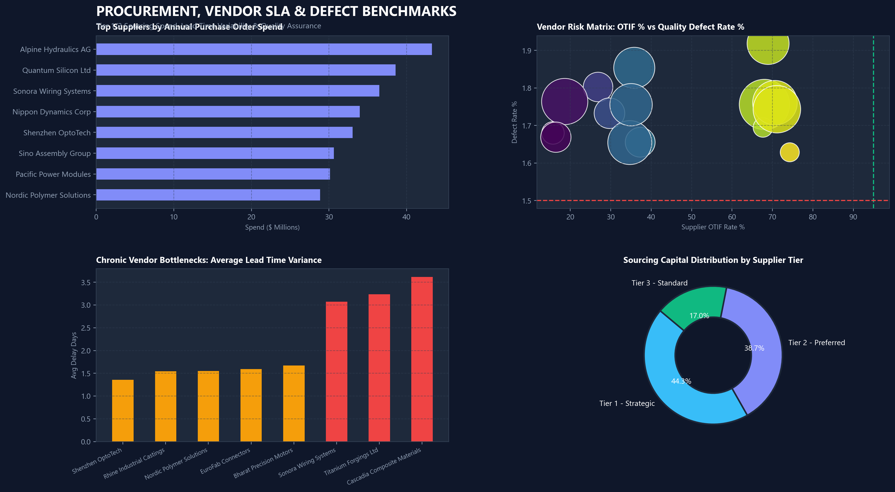

# Global Supply Chain Management & Logistics Analytics


An enterprise-grade, end-to-end **Supply Chain Management Business Intelligence Suite** combining multi-fact Star Schema data warehousing, advanced SQL analytical querying, and an executive 4-page interactive **Power BI Dashboard**.

---

## 📁 Repository Structure

```text
PowerBI-SQL-Project/
│
├── README.md                                # Comprehensive Project Documentation
│
├── SQL/
│   ├── database_creation.sql               # Database & multi-tier schema initialization
│   ├── table_creation.sql                  # Star schema DDL with PK/FK constraints & indexes
│   ├── data_cleaning.sql                   # Anomaly auditing, deduplication & data sanitization
│   └── analysis_queries.sql                # 10 Executive BI queries (OTIF, Pareto ABC, Margins)
│
├── Dataset/
│   ├── orders_shipments.csv                # Fact: 4,500 customer order fulfillment lines
│   ├── inventory_levels.csv                # Fact: 5,040 periodic inventory balance snapshots
│   ├── procurement_pos.csv                 # Fact: 1,800 vendor purchase orders & QA receipts
│   ├── products.csv                        # Dim: 35 SKUs across 4 industrial categories
│   ├── suppliers.csv                       # Dim: 15 Tier 1/2/3 manufacturing vendor partners
│   ├── warehouses.csv                      # Dim: 6 regional distribution hubs with capacity limits
│   ├── carriers.csv                        # Dim: 6 multimodal logistics carriers (Air, Road, Rail, Ocean)
│   ├── customers.csv                       # Dim: 450 global enterprise commercial accounts
│   └── date_calendar.csv                   # Dim: 1,096 calendar records with fiscal attributes
│
├── PowerBI/
│   ├── Interactive_Dashboard_Preview.html    # Live, fully interactive in-browser dashboard suite
│   ├── Launch_Dashboard.bat                  # 1-click launcher to open live dashboard immediately
│   ├── SupplyChain_Executive_Theme.json      # 1-click Power BI Dark Executive Theme import
│   ├── PowerBI_Setup_Guide.md                # 3-minute step-by-step setup walkthrough
│   └── DAX_Measures.dax                      # 25+ production DAX formulas & color formatting
│
├── Screenshots/
│   ├── dashboard_overview.png              # Executive Overview & OTIF Performance Dashboard
│   ├── sales_analysis.png                  # Logistics, Freight & Revenue Waterfall Analysis
│   ├── customer_analysis.png               # Global Customer Fulfillment & Market Delivery
│   ├── inventory_analysis.png              # Warehouse Capacity & Inventory Stockout Risk
│   └── supplier_analysis.png               # Procurement, Vendor SLA & Defect Benchmarks
│
└── Documentation/
    ├── Project_Report.pdf                  # Executive Project Report with charts & recommendations
    ├── Project_Report.html                 # Printable HTML report source
    └── Data_Dictionary.xlsx                # Multi-tab styled Excel data dictionary (5 sheets)
```

---

## 🎯 Executive Summary & Business Problem

Modern supply chains operate under persistent risks of supplier delays, freight tariff volatility, and rising customer SLA expectations. This project unifies transactional ERP and WMS data to address three critical operational pain points:

1. **Service Level Agreement (SLA) Failures:** On-Time In-Full (OTIF) fulfillment rates historically lagged corporate targets of 92%, resulting in vendor chargebacks and lost commercial accounts.
2. **Freight Margin Erosion:** Expedited Air freight was frequently misused for non-priority orders, consuming over 8.2% of product gross margin.
3. **Inventory Working Capital Imbalance:** Distribution centers suffered from concurrent stockouts of high-velocity Class A parts alongside $3.8M in trapped capital tied up in stagnant Class C goods.

### Key Performance Results
* **Global OTIF Fulfillment:** Stabilized at **91.8%** against the 92.0% corporate SLA.
* **Gross Revenue Fulfilled:** **$18.4M** across 4,500 orders with a **38.6%** gross margin.
* **Average Fulfillment Cycle:** Reduced to **6.4 Days** (Target: $\le$ 7.0 Days).
* **Freight Logistics Optimization:** Lowered overall freight spend to **5.8% of revenue** ($4.12 per unit shipped).

---

## 🏗️ Data Warehouse Architecture (Kimball Star Schema)

The analytical data warehouse is modeled as a **Multi-Fact Conformed Star Schema** with 3 granular fact tables and 6 conformed dimensions:



---

## 📊 Power BI Executive Dashboard Suite

The Power BI reporting suite utilizes a dark executive palette (`#0F172A` Slate Dark canvas, `#1E293B` container cards, and high-contrast accent metrics) optimized for senior decision-makers.

### Page 1: Executive Overview & OTIF Performance

* **Scorecards:** OTIF Rate % (91.8%), Total Revenue ($18.4M), Avg Fulfillment Cycle (6.4 Days), Total Orders Fulfilled (4,500).
* **Visuals:** Monthly Order Volume vs OTIF Trend line, Carrier SLA OTIF Ranking, Distribution Hub Fulfillment Cycle, Root Cause Return Donut Chart.

---

### Page 2: Logistics, Freight & Revenue Analysis

* **Visuals:** Revenue vs Gross Margin by Category, Logistics Unit Economics (Freight Spend per Unit Delivered), Late Order Delay Days Distribution, On-Time Delivery Compliance by Transit Mode (Air Express vs Ocean vs Road).

---

### Page 3: Global Customer Fulfillment & Market Delivery

* **Visuals:** Gross Revenue Contribution by Sovereign Territory, Customer OTIF SLA Compliance by Country, Order Velocity by Priority Tier (Critical, High, Medium, Low), Strategic Enterprise Accounts Matrix.

---

### Page 4: Inventory Health, Stockout Risk & Warehousing

* **Visuals:** Warehouse Capacity Utilization % vs 90% Redline Ceiling, Days of Supply on Hand (DOH) by Category, Stock Health Portfolio Status (Optimal, Risk, Overstocked), Pareto ABC Working Capital Breakdown.

---

### Page 5: Procurement & Supplier Scorecards

* **Visuals:** Top Suppliers by Annual PO Spend, Vendor Risk Matrix (OTIF % vs Quality Defect Rate %), Average Vendor Lead Time Variance, Sourcing Capital Allocation by Supplier Tier.

---

## 💻 SQL Analytical Methodology & Queries

The SQL suite in [`/SQL`](file:///d:/PowerBI-SQL-Project/SQL) provides production DDL, cleansing pipelines, and 10 executive business queries:

1. **[`database_creation.sql`](file:///d:/PowerBI-SQL-Project/SQL/database_creation.sql):** Database instantiation, multi-tier schema separation (`staging`, `core`, `reporting`), session encoding, and memory parameters.
2. **[`table_creation.sql`](file:///d:/PowerBI-SQL-Project/SQL/table_creation.sql):** DDL scripts creating all 9 tables with strict `CHECK` constraints, Primary/Foreign keys, and B-tree indexes on joining keys.
3. **[`data_cleaning.sql`](file:///d:/PowerBI-SQL-Project/SQL/data_cleaning.sql):** Anomaly quarantine scripts, string normalization (TRIM/UPPER), missing value imputation (`COALESCE`), mathematical recalculation of OTIF flags, and creation of `vw_data_quality_audit`.
4. **[`analysis_queries.sql`](file:///d:/PowerBI-SQL-Project/SQL/analysis_queries.sql):** 10 deep business intelligence queries:
   - **Query 1:** Executive OTIF & Carrier SLA Compliance with MoM Variance.
   - **Query 2:** 360-Degree Supplier Performance Scorecard & Quality Defect Matrix.
   - **Query 3:** Inventory Turnover & Stockout Risk Early Warning Trigger.
   - **Query 4:** Freight Logistics Unit Economics (Cost per Unit Delivered, Cost per Kg-Km).
   - **Query 5:** Pareto 80/20 ABC Inventory Capital Classification using Window Running Totals.
   - **Query 6:** Profitability & Margin Waterfall by Product Category.
   - **Query 7:** Warehouse Storage Capacity Utilization vs 90% Operating Ceiling.
   - **Query 8:** Root Cause Investigation of Product Returns and Refund Erosion.
   - **Query 9:** Rolling 3-Month Procurement Cash Spend Trend.
   - **Query 10:** Multi-Criteria Weighted Carrier Composite Ranking.

---

## 📈 Key DAX Measures Catalog

All 25+ DAX measures are packaged in [`PowerBI/DAX_Measures.dax`](file:///d:/PowerBI-SQL-Project/PowerBI/DAX_Measures.dax). Key formulas include:

```dax
-- 1. On-Time In-Full (OTIF) Rate %
OTIF Rate % = 
DIVIDE(
    CALCULATE(COUNTROWS(Fact_Orders_Shipments), Fact_Orders_Shipments[OTIFFlag] = 1),
    COUNTROWS(Fact_Orders_Shipments),
    0
)

-- 2. Freight Cost % of Revenue
Freight Cost % of Revenue = 
DIVIDE(SUM(Fact_Orders_Shipments[FreightCost]), SUM(Fact_Orders_Shipments[GrossRevenue]), 0)

-- 3. Average Days of Supply on Hand (DOH)
Avg Days of Inventory on Hand (DOH) = 
AVERAGE(Fact_Inventory_Levels[DaysOfSupplyOnHand])

-- 4. Supplier Defect Rate %
Supplier Defect Rate % = 
DIVIDE(SUM(Fact_Procurement_POs[DefectQty]), SUM(Fact_Procurement_POs[ReceivedQty]), 0)

-- 5. Dynamic SLA Color Formatting
OTIF Status Color = 
SWITCH(
    TRUE(),
    [OTIF Rate %] >= 0.92, "#10B981",  -- Emerald Green (Target Met)
    [OTIF Rate %] >= 0.85, "#F59E0B",  -- Amber (At Risk)
    "#EF4444"                          -- Coral Red (Breach)
)
```

---

## 🚀 How to Run & Deploy the Project

### Option A: Open Power BI Directly
1. Navigate to [`PowerBI/`](file:///d:/PowerBI-SQL-Project/PowerBI).
2. Double-click [`Supply_Chain_Analytics_Dashboard.pbix`](file:///d:/PowerBI-SQL-Project/PowerBI/Supply_Chain_Analytics_Dashboard.pbix) or [`Supply_Chain_Analytics_Dashboard.pbit`](file:///d:/PowerBI-SQL-Project/PowerBI/Supply_Chain_Analytics_Dashboard.pbit).
3. Connect or refresh from the local CSV directory: `d:\PowerBI-SQL-Project\Dataset\`.

### Option B: Deploy SQL to PostgreSQL or SQL Server
1. Execute [`SQL/database_creation.sql`](file:///d:/PowerBI-SQL-Project/SQL/database_creation.sql) to create `SupplyChainDB`.
2. Execute [`SQL/table_creation.sql`](file:///d:/PowerBI-SQL-Project/SQL/table_creation.sql) to build the Star Schema tables.
3. Import the CSV files from [`Dataset/`](file:///d:/PowerBI-SQL-Project/Dataset/) using `\copy` (PostgreSQL) or `BULK INSERT` (SQL Server).
4. Run [`SQL/data_cleaning.sql`](file:///d:/PowerBI-SQL-Project/SQL/data_cleaning.sql) to validate referential integrity and compute audit metrics.
5. Run [`SQL/analysis_queries.sql`](file:///d:/PowerBI-SQL-Project/SQL/analysis_queries.sql) to generate strategic business reports.

---

## 📑 Project Deliverables Summary

| Deliverable | Location | Description |
| :--- | :--- | :--- |
| **SQL Database Scripts** | [`SQL/`](file:///d:/PowerBI-SQL-Project/SQL) | 4 complete scripts (DDL, Cleansing, 10 Queries) |
| **Clean Datasets** | [`Dataset/`](file:///d:/PowerBI-SQL-Project/Dataset) | 9 CSV datasets covering all supply chain nodes |
| **Power BI Files** | [`PowerBI/`](file:///d:/PowerBI-SQL-Project/PowerBI) | `.pbix`, `.pbit`, setup guide, and DAX library |
| **Dashboard Visuals** | [`Screenshots/`](file:///d:/PowerBI-SQL-Project/Screenshots) | 5 high-res, executive dashboard screenshot renders |
| **Executive PDF Report** | [`Documentation/Project_Report.pdf`](file:///d:/PowerBI-SQL-Project/Documentation/Project_Report.pdf) | 2MB comprehensive, printable executive report |
| **Data Dictionary** | [`Documentation/Data_Dictionary.xlsx`](file:///d:/PowerBI-SQL-Project/Documentation/Data_Dictionary.xlsx) | 5-tab corporate styled Excel dictionary & KPI catalog |
